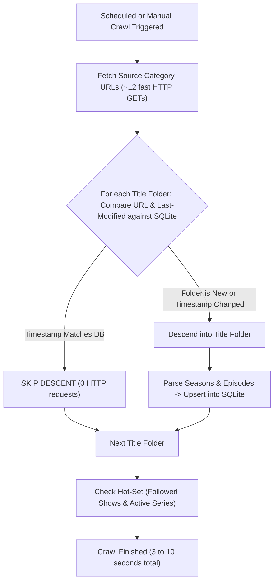

# FTP-Lantern — System Architecture & Implementation Reference (v3.2)

**FTP-Lantern** is an ultra-lightweight, zero-transcoding media indexer, instant search engine, and native streaming launcher tailored for BDIX ISP HTTP media portals (specifically Dhaka-FLIX on `172.16.50.12`, `14`, `7`, `8`, `9`).

It compiles into a single static Go binary with an embedded Svelte 5 SPA, incrementally mirrors ISP directory trees using HTTP `Last-Modified` change detection, caches content-hashed poster thumbnails, provides sub-millisecond FTS5 search with typo tolerance, launches direct external streaming (Windows PotPlayer/VLC, Android VLC/MX Player) with zero media proxying, and sends scheduled daily digests as well as instant notifications for followed shows.

---

## 1. High-Level Architecture & Operating Model

```
ISP BDIX Server (172.16.50.12/DHAKA-FLIX-12/...)
          │  Incremental HTTP crawl (Last-Modified check + Hot-Set Seasons + Deep Crawl)
          ▼
┌───────────────────────── ftp-lantern (Single Go Binary) ─────────────────────────┐
│                                                                                  │
│  ┌────────────────────┐     ┌──────────────────┐     ┌────────────────────────┐  │
│  │   Crawler Engine   │ ──► │   Diff Engine    │ ──► │  SQLite 3 (WAL mode)   │  │
│  │  (Low-Duty Daemon) │     │ (CircuitBreaker) │     │  /data/lantern.db      │  │
│  └─────────┬──────────┘     └────────┬─────────┘     │  - titles, releases    │  │
│            │                         │               │  - files, plays        │  │
│            ▼                         ▼               │  - events, settings    │  │
│    Poster Worker (Q=1)         Telegram Bot          │  - FTS5 trigram index  │  │
│  (Single worker, max 96MB,  (08:01 AM Digest         └───────────┬────────────┘  │
│   /data/thumbs/:id-:hash)    + Instant Follow Alerts             ▲               │
│                              + Bot Listener)                     │ REST API      │
│                                                                  │               │
│                                                      ┌───────────┴────────────┐  │
│                                                      │  Embedded Web UI       │  │
│                                                      │  (Svelte 5 / Vite SPA) │  │
│                                                      │  - History API Nav     │  │
│                                                      │  - PotPlayer/VLC Launch│  │
│                                                      │  - 3-Block Home Shelves│  │
│                                                      └────────────────────────┘  │
└──────────────────────────────────────────────────────────────────────────────────┘
          │
          ├─► Windows Desktops: potplayer:// and vlc:// 1-click launchers + M3U fallback
          ├─► Android Devices: intent://... (navigator.sendBeacon() play tracking)
          ├─► Dokploy Volume: ftp-lantern-data:/data (Persists lantern.db across deploys)
          └─► Telegram Client: Daily 08:01 AM digest + Instant episode alerts on Follow
```

> [!IMPORTANT]
> **Zero 24/7 Background Indexing Loops:**  
> The crawler engine is **NOT** running in a continuous search loop. Outside of the scheduled run (default: **07:00 AM once a day**) or an explicit user trigger (Manual Scan or Turbo Mode), the crawler goroutine is completely idle/dormant. Host CPU usage is $\approx 0\%$, and idle RAM is $< 18 \text{ MB}$.

---

## 2. Technology Stack & Runtime Bounds

| Layer | Selection | Justification & Performance Characteristics |
| :--- | :--- | :--- |
| **Backend Runtime** | **Go 1.26 (`net/http`)** | Single static binary, zero runtime dependencies. Idle RAM $< 18 \text{ MB}$. Goroutines handle concurrent crawling without OS thread overhead. |
| **Timezone & CLI** | **`_ "time/tzdata"` + CLI subcommands** | Embedded timezone database for accurate scheduled runs (`Asia/Dhaka`). Built-in `healthcheck` subcommand eliminates `curl` requirement in `scratch` containers. |
| **Database** | **SQLite + FTS5 (`modernc.org/sqlite`)** | Pure Go SQLite engine (zero CGO). Runs in WAL mode with `synchronous = NORMAL`. Disk queries execute in **1–3 ms**. Zero external database containers needed. |
| **Search Engine** | **FTS5 Trigram via Parameterized `LIKE`** | SQLite accelerates parameterized `LIKE '%' || ? || '%'` directly through FTS5 trigram indexes without fragile syntax escaping. Substring sliding-window Levenshtein fallback handles typos. |
| **Image Pipeline** | **`disintegration/imaging` (Concurrency = 1)** | Dedicated single-worker queue prevents memory spikes (decoding 2000×3000 JPEG consumes ~24MB uncompressed). Resizes to ~300px JPEG Q75. Immutable caching headers. |
| **Crawler Parsing** | **`PuerkitoBio/goquery` (HTML DOM)** | Robust table parser for Dhaka-FLIX custom HTML autoindex structures (`td.fb-n`, `td.fb-d`, `td.fb-s`). |
| **Frontend** | **Svelte 5 (Runes) + Tailwind CSS** | Bundled and embedded directly into the Go binary via `//go:embed`. Initial bundle $< 45 \text{ KB}$ gzipped. Multi-block home layout, category filters, and History API modal navigation. |
| **Deployment** | **Dokploy / Docker (`network_mode: host`)** | Minimal `scratch` container ($< 25 \text{ MB}$). Direct host routing to bypass Docker bridge NAT collisions with `172.16.50.12`. Named persistent volume for `/data`. |

---

## 3. Storage Persistence & Dokploy Volume Setup

### 3.1 Why Data Was Lost on Previous Rebuilds
In Dokploy, when an application is deployed via Docker Compose, Docker creates ephemeral or project-prefixed containers. If volumes are not declared as persistent named volumes or registered in Dokploy's UI, commands like `docker compose down` or `up --build --remove-orphans` can recreate anonymous volumes, losing `/data/lantern.db` and `/data/thumbs/`.

### 3.2 Dokploy Persistent Volume Configuration (Step-by-Step)
To guarantee your database and thumbnails survive every deploy, update, and server restart:

1. Open **Dokploy** &rarr; Navigate to your project **`Self-made Apps / production / ftp-lantern`**.
2. Click the **Advanced** tab (or the **Volumes** section).
3. Under the **Volumes** card (currently showing *"No volumes/mounts configured"*), click **"+ Add Volume"**.
4. Configure the volume:
   - **Type:** `Volume` (Named Volume) OR `Bind Mount` (Host Path).
     - *If selecting Volume (Recommended):*
       - **Volume Name:** `ftp-lantern-data`
       - **Mount Path:** `/data`
     - *If selecting Bind Mount:*
       - **Host Path:** `/var/lib/dokploy/volumes/ftp-lantern-data` (or `/home/riad/lantern-data`)
       - **Mount Path:** `/data`
5. Click **Save** and redeploy.

```
Dokploy Host Filesystem
  └── /var/lib/docker/volumes/ftp-lantern-data/_data/
       ├── lantern.db         (SQLite database - WAL mode)
       ├── lantern.db-wal     (WAL write-ahead log)
       ├── lantern.db-shm     (Shared memory index)
       └── thumbs/            (Resized cached JPEG posters)
            └── 42-a8f9b2.jpg
```

### 3.3 Dokploy Built-in Automated Backups
Once the volume is registered under Dokploy's Volumes section:
- The top-level **"Volume Backups"** tab in Dokploy recognizes `ftp-lantern-data`.
- You can configure automated daily or weekly volume snapshots to an S3 destination or local disk backup path.
- In case of server migration, Dokploy can restore the volume with a single click.

### 3.4 Storage Bloat & Footprint Safety
- **SQLite Variable-Length Integer Storage:** Adding file size metrics (`size_bytes`) adds $\le 4 \text{ bytes}$ per file record. For a 100,000-file library, total database size increases by less than **500 KB**.
- **WAL Auto-Checkpointing:** SQLite is configured with `PRAGMA wal_autocheckpoint = 1000`, keeping the WAL file small ($< 4 \text{ MB}$).
- **Poster Thumbnail Caching Cap:** Thumbnails are constrained by `MAX_THUMBS_MB=250`. When storage reaches 250 MB, an LRU sweeper automatically prunes cold thumbnails.

---

## 4. Ultra-Fast Incremental Tree Indexing & Change Detection

### 4.1 The ISP Directory Tree Hierarchy
The BDIX server (`http://172.16.50.12/DHAKA-FLIX-12/`) organizes media into a rigid tree:
- **Level 0 (Source Roots):** `SOURCE_URLS` entries (e.g. `/TV-WEB-Series/`, `/English Movies (1080p)/`).
- **Level 1 (Subcategories / Alphabetical Folders):** e.g. `TV Series * A - L/`, `TV Series * M - R/`, or direct title listings.
- **Level 2 (Title Folders):** e.g. `Breaking Bad/`, `Inception (2010)/`.
- **Level 3 (Season Folders / Files):** `Season 01/`, `Season 02/` or direct `.mkv`/`.mp4` media files.
- **Level 4 (Episode Files):** `Breaking.Bad.S01E01.1080p.mkv`.

### 4.2 How HTTP Autoindex Provides Free Change Detection
The ISP web server runs an Apache/Nginx autoindex view. Every directory page contains:
- Directory link: `<td class="fb-n"><a href="Breaking%20Bad/">Breaking Bad/</a></td>`
- Last Modified timestamp: `<td class="fb-d">2026-08-14 18:22</td>`
- Size/Type: `<td class="fb-s">Folder</td>`

Because Linux filesystem directory modification times (`mtime`) update whenever an entry is added or removed inside that directory:
1. **Title Folders:** If no new seasons or files were added to `Breaking Bad/`, its timestamp remains identical across days, months, and years.
2. **Movie Folders:** Once indexed, a movie's folder timestamp never changes.

### 4.3 Two-Tier Incremental Crawl Mechanics


1. **Category Listing Check (Level-1 Skip):**
   - The crawler lists the top category pages.
   - For every title folder found in the HTML table, it queries SQLite:
     ```sql
     SELECT id, last_modified FROM releases WHERE folder_url = ?
     ```
   - If the folder exists and its `last_modified` string matches the HTML table's timestamp, **the crawler completely skips descending**.
   - Scanning 2,000 title folders takes **$< 2 \text{ seconds}$** because no recursive HTTP requests are made.
2. **Descent Only on Modification:**
   - A descent occurs **only** when:
     - The folder URL is brand new (new movie or newly added series).
     - The folder timestamp changed (a new season was added to an existing show).
3. **Followed Shows & Active Hot-Set Check:**
   - If a new episode is added *inside* an existing season folder (e.g. `Season 01/S01E08.mkv`), the title root timestamp might not propagate.
   - To catch this with zero bloat, the crawler checks **only active shows**:
     ```sql
     SELECT folder_url FROM releases 
     WHERE title_id IN (
         SELECT id FROM titles WHERE is_following = 1
     ) OR last_modified > datetime('now', '-45 days')
     ```
   - Re-checks only the active season folders of followed shows (~20–40 fast requests).
4. **Performance Outcome:**
   - **First Crawl (Cold Database):** Complete recursive walk (~2–4 minutes depending on ISP speed).
   - **Subsequent Daily Crawls:** **3 to 10 seconds total**, consuming negligible network bandwidth and CPU.

---

## 5. Crawler Duty Cycle, Scheduler & Notification Rhythm

### 5.1 Duty Cycle & Startup Safeguards
- **Zero 24/7 Scanning:** The container process hosts the HTTP server on port `8087`. The background crawler sleeps and executes only when triggered.
- **Smart Startup Behavior:**
  - On container startup/restart, the application checks `SELECT COUNT(*) FROM titles`.
  - If titles already exist in the database, it **skips initial scan** and enters standby mode immediately.
  - If the database is completely empty (fresh install), it performs an initial background seed crawl.

### 5.2 Crawl Frequency Configuration (Settings Modal)
Users can configure the crawl rhythm in the Settings modal:
- **Frequency Options:**
  - `Once Daily` (Default): Crawls once every 24 hours at the configured hour.
  - `Twice Daily`: Crawls at 07:00 AM and 07:00 PM.
  - `Every 12 Hours`: Crawls every 12 hours.
  - `Manual Only`: Crawler remains disabled until the user clicks "Run Scan Now" or sends `/scan` via Telegram.
- **Configurable Crawl Time:** Selectable hour (default: `07:00 AM` Asia/Dhaka).

### 5.3 Notification Rhythm & Follow System
1. **Daily Digest (08:01 AM Asia/Dhaka):**
   - Dispatches a consolidated HTML morning report summarizing everything indexed in the last 24 hours.
   - Formatted with titles and release years: `Title (Year)`.
2. **Instant Follow Alerts (⭐ Starred Shows):**
   - When a user clicks **Follow** on an ongoing series, `is_following` is set to `1`.
   - As soon as any scheduled, manual, or Turbo crawl detects a new file/episode for that series, an **immediate Telegram alert** is dispatched:
     `🔔 New Episode Alert: Lanterns (2026) — S01E07 (1080p)`
3. **Turbo Scan Mode:**
   - Designed for days when new episodes or movies are actively releasing.
   - Crawls every **15 minutes** for a user-specified duration:
     `1 Hour`, `3 Hours`, `6 Hours`, `12 Hours`, `24 Hours (1 Day)`, `3 Days`, or `7 Days (Max)`.
   - Displays a live "Turbo Active" badge in the web UI navbar with countdown.

---

## 6. Frontend UI Architecture & Accessibility Improvements

### 6.1 Multi-Block Home Architecture
The homepage is organized into three distinct, responsive blocks:
1. **Block 1 — Recently Added (What's New):**
   - Expandable shelf displaying newly discovered releases across all ISP categories with quick resolution and size badges.
2. **Block 2 — Movies Shelf:**
   - Dedicated movie shelf with horizontal scrolling and quick ISP category filter chips (*English Movies*, *English 1080p*, *Hindi*, *South Hindi Dubbed*, *Bangla*, *Animation*, *IMDb Top-250*).
   - "Explore All Movies" button routing directly to the full movie library grid.
3. **Block 3 — TV Series Shelf:**
   - Dedicated TV series shelf with quick filters (*English*, *Hindi*, *Bengali*, *Korean*, *Anime & Cartoons*, *Documentaries*).
   - "Explore All Series" button routing to the full series grid.

### 6.2 Horizontal Scrolling & Quick Filter Fix
- **The Issue:** On various screen widths, flex rows without explicit nowrap and touch overflow can wrap or clip chips (e.g. `Foreign Mo...`).
- **The Architectural Fix:**
  - Parent containers enforce `w-full min-w-0 flex items-center gap-2 overflow-x-auto whitespace-nowrap`.
  - Custom sleek scrollbar styles (`scrollbar-thin scrollbar-thumb-zinc-800 scrollbar-track-transparent`).
  - Added `-webkit-overflow-scrolling: touch` for buttery smooth mouse wheel and touch gestures.
  - Category chips retain `flex-shrink-0` to guarantee text labels never truncate.

### 6.3 Browser & Mouse Navigation (History API Integration)
- Modals (`TitleDetailModal`, `SettingsModal`, `VideoPreviewModal`) push a state to `window.history` when opened (`window.history.pushState({ modal: 'title', id }, '')`).
- **Mouse Back / Forward Buttons:**
  - Clicking the mouse back button (or browser back button) fires `window.addEventListener('popstate')`, which cleanly closes the open modal without leaving the app or navigating away.
  - Closing a modal via the 'X' button or backdrop click invokes `window.history.back()`, preventing phantom history entries.

### 6.4 1-Click Streaming Launchers (Bypassing Insecure Download Warnings)
- Chrome flags `.m3u` file downloads over plain HTTP as "Insecure download blocked".
- **Primary Solution:** 1-Click native launcher links using custom URI schemes:
  - **PotPlayer:** `potplayer://http://172.16.50.12/DHAKA-FLIX-12/.../video.mkv`
  - **VLC Media Player:** `vlc://http://172.16.50.12/DHAKA-FLIX-12/.../video.mkv`
  - Launches media directly into the local desktop player with **zero file downloads**.
- **Secondary Solution:** "Copy Stream Link" button for 1-click clipboard copy.
- **Fallback M3U Header:** Serves `X-Content-Type-Options: nosniff` and `Content-Disposition: attachment; filename="clean-name.m3u"`.

---

## 7. Database Schema Reference

```sql
PRAGMA journal_mode = WAL;
PRAGMA synchronous = NORMAL;
PRAGMA foreign_keys = ON;

-- Logical Titles Table
CREATE TABLE IF NOT EXISTS titles (
    id            INTEGER PRIMARY KEY AUTOINCREMENT,
    name          TEXT NOT NULL,
    name_norm     TEXT NOT NULL,
    year          INTEGER NOT NULL DEFAULT 0,
    type          TEXT NOT NULL DEFAULT 'series', -- 'series' or 'movie'
    poster_url    TEXT,
    thumb_hash    TEXT,
    is_following  INTEGER NOT NULL DEFAULT 0,
    first_seen    DATETIME NOT NULL DEFAULT CURRENT_TIMESTAMP,
    last_modified DATETIME,
    UNIQUE(name_norm, year)
);

-- Releases Table (Folders on ISP server)
CREATE TABLE IF NOT EXISTS releases (
    id            INTEGER PRIMARY KEY AUTOINCREMENT,
    title_id      INTEGER NOT NULL REFERENCES titles(id) ON DELETE CASCADE,
    source_server TEXT NOT NULL DEFAULT 'DHAKA-FLIX-12',
    category      TEXT NOT NULL,
    folder_url    TEXT NOT NULL UNIQUE,
    folder_name   TEXT NOT NULL,
    resolution    TEXT NOT NULL DEFAULT 'Unknown',
    source        TEXT NOT NULL DEFAULT 'Unknown',
    has_hdr       INTEGER NOT NULL DEFAULT 0,
    first_seen    DATETIME NOT NULL DEFAULT CURRENT_TIMESTAMP,
    last_modified DATETIME,
    gone_at       DATETIME
);

-- Files Table (Episodes & Movie Files with Byte Size)
CREATE TABLE IF NOT EXISTS files (
    id            INTEGER PRIMARY KEY AUTOINCREMENT,
    title_id      INTEGER NOT NULL REFERENCES titles(id) ON DELETE CASCADE,
    release_id    INTEGER NOT NULL REFERENCES releases(id) ON DELETE CASCADE,
    season_num    INTEGER NOT NULL DEFAULT 0,
    episode_num   INTEGER NOT NULL DEFAULT 0,
    file_name     TEXT NOT NULL,
    file_url      TEXT NOT NULL UNIQUE,
    file_size_bytes INTEGER NOT NULL DEFAULT 0,
    last_modified DATETIME,
    first_seen    DATETIME NOT NULL DEFAULT CURRENT_TIMESTAMP,
    gone_at       DATETIME
);

-- Playback History Table
CREATE TABLE IF NOT EXISTS plays (
    id            INTEGER PRIMARY KEY AUTOINCREMENT,
    file_id       INTEGER NOT NULL REFERENCES files(id) ON DELETE CASCADE,
    title_id      INTEGER NOT NULL REFERENCES titles(id) ON DELETE CASCADE,
    played_at     DATETIME NOT NULL DEFAULT CURRENT_TIMESTAMP
);

-- App Settings & Key-Value Store
CREATE TABLE IF NOT EXISTS settings (
    key           TEXT PRIMARY KEY,
    value         TEXT NOT NULL,
    updated_at    DATETIME NOT NULL DEFAULT CURRENT_TIMESTAMP
);

-- FTS5 Trigram Table for Sub-Millisecond Search
CREATE VIRTUAL TABLE IF NOT EXISTS titles_fts USING fts5(
    name_norm,
    content='titles',
    content_rowid='id',
    tokenize='trigram'
);
```

---

## 8. Deployment Specification (`docker-compose.yml`)

```yaml
services:
  ftp-lantern:
    build:
      context: .
      dockerfile: Dockerfile
    container_name: ftp-lantern
    network_mode: host
    restart: unless-stopped
    volumes:
      - lantern-data:/data
    environment:
      - PORT=8087
      - SOURCE_URLS=http://172.16.50.12/DHAKA-FLIX-12/TV-WEB-Series/,http://172.16.50.14/DHAKA-FLIX-14/English%20Movies%20%281080p%29/,http://172.16.50.7/DHAKA-FLIX-7/English%20Movies/,http://172.16.50.14/DHAKA-FLIX-14/Hindi%20Movies/,http://172.16.50.14/DHAKA-FLIX-14/IMDb%20Top-250%20Movies/,http://172.16.50.14/DHAKA-FLIX-14/Animation%20Movies%20%281080p%29/,http://172.16.50.14/DHAKA-FLIX-14/KOREAN%20TV%20%26%20WEB%20Series/,http://172.16.50.9/DHAKA-FLIX-9/Anime%20%26%20Cartoon%20TV%20Series/,http://172.16.50.7/DHAKA-FLIX-7/Kolkata%20Bangla%20Movies/,http://172.16.50.7/DHAKA-FLIX-7/Foreign%20Language%20Movies/,http://172.16.50.14/DHAKA-FLIX-14/SOUTH%20INDIAN%20MOVIES/South%20Movies/,http://172.16.50.14/DHAKA-FLIX-14/SOUTH%20INDIAN%20MOVIES/Hindi%20Dubbed/
      - CRAWL_SCHEDULE=07:00
      - CRAWL_FREQUENCY=daily
      - CRAWL_CONCURRENCY=4
      - GOMEMLIMIT=96MiB
      - MAX_THUMBS_MB=250
      - PUBLIC_BASE_URL=${PUBLIC_BASE_URL:-http://ftp.com}
      - TELEGRAM_BOT_TOKEN=${TELEGRAM_BOT_TOKEN}
      - TELEGRAM_ADMIN_CHAT_ID=${TELEGRAM_ADMIN_CHAT_ID}
      - TZ=Asia/Dhaka
      - LOG_LEVEL=info
    deploy:
      resources:
        limits:
          cpus: '0.50'
          memory: 128M

volumes:
  lantern-data:
    name: ftp-lantern-data
```

---

## 9. Verification & Performance Bounds

- **Container Image Size:** $\le 25 \text{ MB}$.
- **Host Memory Footprint:** $\le 30 \text{ MB}$ under peak crawl; $< 18 \text{ MB}$ at idle.
- **Incremental Crawl Time:** $\le 10 \text{ seconds}$ across 12 source categories via Level-1 `Last-Modified` skip mechanics.
- **Search Latency:** $\le 3 \text{ ms}$ for FTS5 trigram queries across 10,000+ items.
- **Zero-Secret Compliance:** 100% environment-driven configuration with no hardcoded IPs, bot tokens, or chat IDs in source code.
