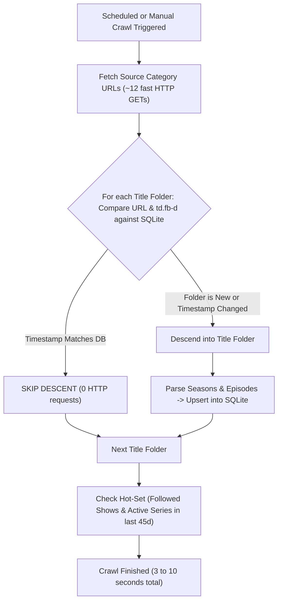
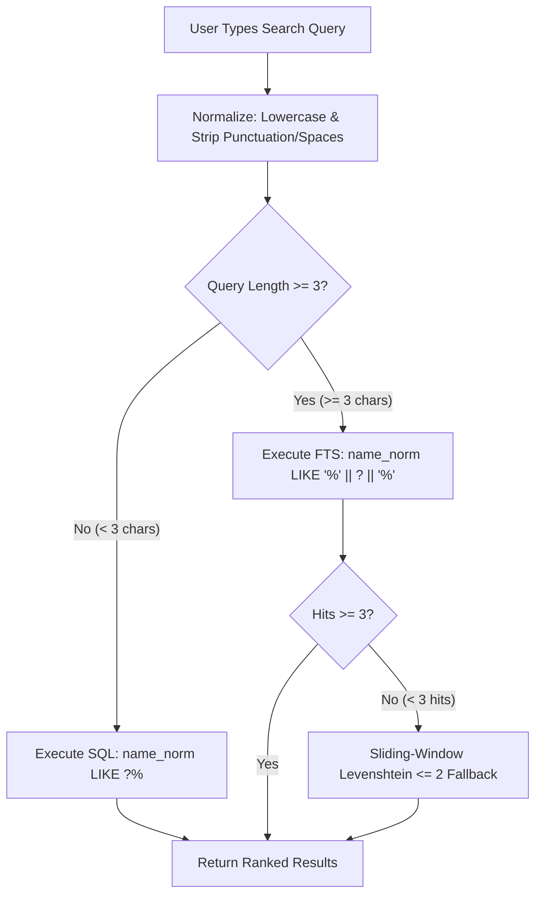

# FTP-Lantern — System Architecture & Implementation Reference (v3.3)

**FTP-Lantern** is an ultra-lightweight, zero-transcoding media indexing, instant search engine, and native streaming launcher tailored for BDIX ISP HTTP media portals (specifically Dhaka-FLIX on `172.16.50.12`, `14`, `7`, `8`, `9`).

It compiles into a single static Go binary with an embedded Svelte 5 SPA, incrementally mirrors ISP directory trees using HTTP HTML autoindex `Last-Modified` change detection, caches content-hashed poster thumbnails, provides sub-millisecond FTS5 search with typo tolerance, launches direct external streaming (Windows PotPlayer/VLC, Android VLC/MX Player) with zero media proxying, and sends scheduled daily digests as well as instant notifications for followed shows.

---

## 1. High-Level Architecture & Operating Model

```
ISP BDIX Server (172.16.50.12, 14, 7, 9 / DHAKA-FLIX-*)
          │  Incremental HTTP crawl (Autoindex Last-Modified check + Hot-Set Season re-list)
          ▼
┌───────────────────────── ftp-lantern (Single Go Binary) ─────────────────────────┐
│                                                                                  │
│  ┌────────────────────┐     ┌──────────────────┐     ┌────────────────────────┐  │
│  │   Crawler Engine   │ ──► │   Diff Engine    │ ──► │  SQLite 3 (WAL mode)   │  │
│  │  (Low-Duty Daemon) │     │ (CircuitBreaker) │     │  /data/lantern.db      │  │
│  └─────────┬──────────┘     └────────┬─────────┘     │  - titles, releases    │  │
│            │                         │               │  - files, plays        │  │
│            ▼                         ▼               │  - events, settings    │  │
│    Poster Worker (Q=1)         Telegram Bot          │  - FTS5 trigram index  │  │
│  (Single worker, max 96MB,  (08:01 AM Digest         └───────────┬────────────┘  │
│   /data/thumbs/:id-:hash)    + Instant Follow Alerts             ▲               │
│                              + Bot Listener)                     │ REST API      │
│                                                                  │               │
│                                                      ┌───────────┴────────────┐  │
│                                                      │  Embedded Web UI       │  │
│                                                      │  (Svelte 5 / Vite SPA) │  │
│                                                      │  - History API Nav     │  │
│                                                      │  - PotPlayer Launch    │  │
│                                                      │  - 3-Block Home Shelves│  │
│                                                      └────────────────────────┘  │
└──────────────────────────────────────────────────────────────────────────────────┘
          │
          ├─► Windows Desktops: potplayer:// (Primary) and vlc:// (Secondary) + M3U playlist fallback
          ├─► Android Devices: intent://... (navigator.sendBeacon() play tracking)
          ├─► Dokploy Volume: ftp-lantern-data:/data (Persists lantern.db across deploys)
          └─► Telegram Client: Daily 08:01 AM digest + Instant episode alerts on Follow + Bot listener
```

> [!IMPORTANT]
> **Zero 24/7 Background Indexing Loops:**  
> The crawler engine is **NOT** running in a continuous search loop. Outside of scheduled execution (configurable in Settings: `15m`, `30m`, `1h`, or `daily at 7:00 AM`) or an explicit user trigger (Manual Scan or Turbo Mode), the crawler goroutine is completely idle/dormant. Host CPU usage is $\approx 0\%$, and idle RAM is $< 18 \text{ MB}$.

---

## 2. Technology Stack & Runtime Bounds

| Layer | Selection | Justification & Performance Characteristics |
| :--- | :--- | :--- |
| **Backend Runtime** | **Go 1.26 (`net/http`)** | Single static binary, zero runtime dependencies. Idle RAM $< 18 \text{ MB}$. Goroutines handle concurrent crawling without OS thread overhead. |
| **Timezone & CLI** | **`_ "time/tzdata"` + CLI subcommands** | Embedded timezone database for accurate scheduled runs (`Asia/Dhaka`). Built-in `healthcheck` subcommand eliminates `curl` requirement in `scratch` containers. |
| **Database** | **SQLite + FTS5 (`modernc.org/sqlite`)** | Pure Go SQLite engine (zero CGO). Runs in WAL mode with `synchronous = NORMAL`. Disk queries execute in **1–3 ms**. Zero external database containers needed. |
| **Search Engine** | **FTS5 Trigram via Parameterized `LIKE`** | SQLite accelerates parameterized `LIKE '%' || ? || '%'` directly through FTS5 trigram indexes with automated sync triggers. Substring sliding-window Levenshtein fallback handles typos. |
| **Image Pipeline** | **`disintegration/imaging` (Concurrency = 1)** | Dedicated single-worker queue prevents memory spikes (decoding 2000×3000 JPEG consumes ~24MB uncompressed). Resizes to ~300px JPEG Q75. Immutable caching headers. |
| **Crawler Parsing** | **`PuerkitoBio/goquery` (HTML DOM)** | Robust table parser for Dhaka-FLIX custom HTML autoindex structures (`td.fb-n`, `td.fb-d`, `td.fb-s`). |
| **Frontend** | **Svelte 5 (Runes) + Tailwind CSS** | Bundled and embedded directly into the Go binary via `//go:embed`. Initial bundle $< 45 \text{ KB}$ gzipped. Multi-block home layout, horizontal scrolling categories, and History API modal navigation. |
| **Deployment** | **Dokploy / Docker (`network_mode: host`)** | Minimal `scratch` container ($< 25 \text{ MB}$). Direct host routing to bypass Docker bridge NAT collisions with `172.16.50.12`. Named persistent volume for `/data`. |

---

## 3. Storage Persistence & Dokploy Volume Setup

### 3.1 Understanding Dokploy Compose vs Application Volumes
- In Dokploy, when deploying via **Docker Compose** (`docker-compose.yml`), Dokploy's UI "Volumes / Mounts" dialog only creates **File Mounts** (mounting custom config files like `.env` into the container).
- Compose volume storage is governed **directly inside `docker-compose.yml`**.
- If a volume is undeclared or anonymous, Dokploy commands like `up -d --build --remove-orphans` recreate containers with a clean ephemeral layer, losing `/data/lantern.db`.

### 3.2 Permanent Persistence Configuration (Two Approved Methods)

#### Method A: Named External Docker Volume (Recommended)
1. SSH into the homelab server or run once via Dokploy host terminal:
   ```bash
   docker volume create ftp-lantern-data
   ```
2. In `docker-compose.yml`, define the volume:
   ```yaml
   services:
     ftp-lantern:
       volumes:
         - lantern-data:/data
   
   volumes:
     lantern-data:
       name: ftp-lantern-data
   ```
   Because `ftp-lantern-data` is a persistent named volume, Docker and Dokploy will **NEVER** delete or wipe it during git pulls, rebuilds, or container redeployments.

#### Method B: Host Bind Mount
If direct host visibility is preferred:
```yaml
    volumes:
      - /var/lib/ftp-lantern/data:/data
```

### 3.3 Safe, Non-Locking Database Snapshots (`VACUUM INTO`)
Copying a live SQLite database in WAL mode (`lantern.db`) while active writes are happening can yield an inconsistent or corrupt copy.
FTP-Lantern provides a built-in snapshot command:
```sql
VACUUM INTO '/data/lantern_backup.db';
```
- Endpoint: `POST /api/backup` (available in Settings UI).
- Creates an atomic, standalone, defragmented snapshot of the entire database into `/data/lantern_backup.db` without locking queries or blocking the crawler.

---

## 4. Ultra-Fast Incremental Tree Indexing & Change Detection

### 4.1 The ISP Directory Tree Hierarchy
The BDIX servers organize media into a structured tree:
- **Level 0 (Source Roots):** `SOURCE_URLS` entries (e.g. `http://172.16.50.12/DHAKA-FLIX-12/TV-WEB-Series/`, `http://172.16.50.14/DHAKA-FLIX-14/English Movies (1080p)/`).
- **Level 1 (Subcategories / Alphabetical Folders):** e.g. `TV Series * A - L/`, `TV Series * M - R/`, or direct title listings.
- **Level 2 (Title Folders):** e.g. `Breaking Bad/`, `Inception (2010)/`.
- **Level 3 (Season Folders / Files):** `Season 01/`, `Season 02/` or direct `.mkv`/`.mp4` media files.
- **Level 4 (Episode Files):** `Breaking.Bad.S01E01.1080p.mkv`.

### 4.2 Autoindex Table Timestamps (DOM Parsing)
> [!NOTE]
> Change detection uses the **timestamp column text in the HTML directory listing table (`td.fb-d`)**, NOT HTTP `HEAD` request headers.

Every directory listing rendered by the ISP server contains:
- Directory link: `<td class="fb-n"><a href="Breaking%20Bad/">Breaking Bad/</a></td>`
- Last Modified date text: `<td class="fb-d">2026-08-14 18:22</td>`
- Size/Type: `<td class="fb-s">Folder</td>`

Because Linux filesystem directory modification times (`mtime`) update whenever an entry is added or removed inside that directory:
1. **Title Folders:** If no new seasons or files were added to `Breaking Bad/`, its timestamp remains identical across days, months, and years.
2. **Movie Folders:** Once indexed, a movie's folder timestamp never changes.

### 4.3 Two-Tier Incremental Crawl Mechanics



1. **Category Listing Check (Level-1 Skip):**
   - The crawler lists the ~12 source category URLs.
   - For every title folder found in the HTML table, it queries SQLite:
     ```sql
     SELECT id, last_modified FROM releases WHERE folder_url = ?
     ```
   - If the folder exists and its `last_modified` string matches the HTML table's timestamp, **the crawler completely skips descending**.
   - Scanning 2,000 title folders takes **$< 2 \text{ seconds}$** with 0 recursive requests.
2. **Descent Only on Modification:**
   - A descent occurs **only** when:
     - The folder URL is brand new (new movie or newly added series).
     - The folder timestamp changed (a new season was added to an existing show).
3. **Hot-Set Season Check (Catches Unfollowed Ongoing Shows):**
   - When an episode is added inside `Season 01/` (e.g. `S01E08.mkv`), `Season 01/`'s timestamp updates, but the title folder timestamp may not propagate.
   - To catch every new episode across all ongoing shows without a heavy full scan, the crawler queries:
     ```sql
     SELECT t.id, r.id, r.folder_url, r.folder_name, r.category
     FROM titles t
     JOIN releases r ON r.title_id = t.id
     WHERE r.gone_at IS NULL AND (
         t.is_following = 1 OR (
             SELECT MAX(f.last_modified) FROM files f WHERE f.release_id = r.id AND f.gone_at IS NULL
         ) > datetime('now', '-45 days')
     )
     ```
   - Re-lists only the season folders of hot shows (~20–40 fast requests).
4. **Non-Blocking Crawl Lock:**
   - Protected by `sync.Mutex.TryLock()`. If a crawl is already running, triggering a new crawl returns `409 Conflict ("Crawl already in progress")`.
5. **Safe Diff & Subtree Mass-Deletion Guard:**
   - Network errors, ISP timeouts, or 5xx responses never trigger deletions.
   - Deletion checks operate strictly on the subtrees actually scanned.
   - If $> 20\%$ of items disappear within a scanned subtree (minimum threshold $\ge 10$ items), all deletions in that subtree are aborted, and an alert is logged.
6. **Strict URL Percent-Encoding:**
   - ISP paths contain characters like `♦`, `—`, `[ ]`, spaces, and `#`.
   - URLs are constructed strictly using Go's `net/url` package (`url.URL{Path: ...}`), never raw string concatenation.

---

## 5. Crawler Duty Cycle, Scheduler & Notification Queue

### 5.1 Startup Behavior & Catch-Up Logic
- **No Redundant Re-Scans:** When the container starts or restarts:
  - It checks `SELECT COUNT(*) FROM titles`.
  - If titles exist, it inspects `last_crawl_time`.
  - If the last crawl was recent ($< 24 \text{ hours}$ ago), it **skips the boot crawl** and enters standby mode immediately.
  - If the last crawl was missed ($> 24 \text{ hours}$ ago due to host downtime) or if the database is empty (fresh install), it performs a catch-up/seed crawl.

### 5.2 Configurable Crawl Frequency (Settings UI)
Users can select the crawl frequency from the Settings modal:
- `Every 15 Minutes (Recommended)`: Takes 3–10 seconds per run, negligible load, provides near real-time updates.
- `Every 30 Minutes`
- `Every 1 Hour`
- `Once Daily at 7:00 AM`
- `Manual Scan Only`: Crawls only when the user clicks "Run Scan Now" or sends `/scan` on Telegram.

### 5.3 Decoupled Event Queue & Delivery Guarantees
```sql
CREATE TABLE IF NOT EXISTS events (
    id              INTEGER PRIMARY KEY AUTOINCREMENT,
    kind            TEXT NOT NULL,
    title_id        INTEGER NOT NULL REFERENCES titles(id) ON DELETE CASCADE,
    release_id      INTEGER REFERENCES releases(id) ON DELETE CASCADE,
    payload_json    TEXT NOT NULL,
    created_at      DATETIME NOT NULL DEFAULT CURRENT_TIMESTAMP,
    notified_at     DATETIME,
    instant_sent_at DATETIME,
    digest_sent_at  DATETIME,
    failed_at       DATETIME
);
```

1. **Silent Initial Seed:**
   - During the first crawl (`isSeed == true`), events are inserted with `instant_sent_at = CURRENT_TIMESTAMP` and `digest_sent_at = CURRENT_TIMESTAMP`.
   - Completely prevents blasting the entire 10,000-title library to Telegram on initial setup.
2. **Instant Follow Alerts (⭐ Starred Shows):**
   - As soon as a crawl detects a new episode for a followed title (`is_following = 1`), it dispatches immediately and sets `instant_sent_at = CURRENT_TIMESTAMP`.
3. **Daily Digest (08:01 AM Asia/Dhaka):**
   - Dispatches a consolidated HTML morning report summarizing all updates where `digest_sent_at IS NULL AND failed_at IS NULL`.
   - If Telegram is unreachable, items remain in the queue with `digest_sent_at IS NULL` and are delivered on the next successful run without data loss.

### 5.4 Telegram Bot & Notifier Specification
- **Strict HTML Escaping:** Dynamic title strings are escaped with `html.EscapeString()`.
- **Item-Boundary Truncation:** Appends items measuring escaped length; stops cleanly before 3,800 characters, appending `...and X more`.
- **Error Classification:**
  - `401 / 403`: Pauses notifier and alerts admin.
  - `429 Rate Limit`: Sleeps for backoff duration.
  - `400 Bad Entity`: Marks only that single event as `failed_at = CURRENT_TIMESTAMP` to prevent queue deadlocks.
- **Long-Polling Bot Listener:**
  - `/status` — Reports total titles, total files, and system health.
  - `/turbo [hours]` — Activates 15-minute Turbo Scan for specified hours.
  - `/scan` — Triggers an immediate crawl.

---

## 6. Instant Search with Parameterized Trigram FTS5 & Typo Tolerance



### 6.1 FTS5 Automated Sync Triggers
```sql
CREATE TRIGGER IF NOT EXISTS titles_ai AFTER INSERT ON titles BEGIN
    INSERT INTO titles_fts(rowid, name_norm) VALUES (new.id, new.name_norm);
END;

CREATE TRIGGER IF NOT EXISTS titles_ad AFTER DELETE ON titles BEGIN
    INSERT INTO titles_fts(titles_fts, rowid, name_norm) VALUES('delete', old.id, old.name_norm);
END;

CREATE TRIGGER IF NOT EXISTS titles_au AFTER UPDATE OF name_norm ON titles BEGIN
    INSERT INTO titles_fts(titles_fts, rowid, name_norm) VALUES('delete', old.id, old.name_norm);
    INSERT INTO titles_fts(rowid, name_norm) VALUES (new.id, new.name_norm);
END;
```

---

## 7. 1-Click Streaming & Native Player Launchers

### 7.1 Desktop Playback (Windows)
- **Primary Launcher — Daum PotPlayer:**
  - Button launches: `potplayer://http://172.16.50.12/DHAKA-FLIX-12/.../video.mkv`
  - PotPlayer registers the `potplayer://` URL protocol natively on Windows.
  - Direct zero-download playback eliminates Chrome's "Insecure download blocked" warning.
- **Secondary Launcher — VLC Media Player:**
  - Button launches: `vlc://http://172.16.50.12/DHAKA-FLIX-12/.../video.mkv` (requires `vlc-protocol` handler on stock Windows).
- **M3U Playlist Fallback:**
  - `GET /play/season/:id.m3u` serves natural `S01E01` UTF-8 playlist with `X-Content-Type-Options: nosniff`.
- **Copy Stream URL:** 1-click clipboard copy of the direct HTTP stream link.

### 7.2 Mobile Playback (Android)
```javascript
function playOnAndroid(fileId, streamUrl, titleName) {
  navigator.sendBeacon('/api/plays', JSON.stringify({ file_id: fileId }));
  const cleanTitle = encodeURIComponent(titleName);
  window.location.href = `intent:${streamUrl}#Intent;type=video/*;title=${cleanTitle};package=org.videolan.vlc;S.browser_fallback_url=${encodeURIComponent(streamUrl)};end;`;
}
```

---

## 8. Frontend UI Architecture & Accessibility Improvements

### 8.1 Multi-Block Home Architecture
1. **Block 1 — Recently Added:** Expandable shelf displaying newly discovered media.
2. **Block 2 — Movies Shelf:** Direct shelf featuring top movies with ISP category chips (*English Movies*, *English 1080p*, *Hindi*, *South Hindi Dubbed*, *Bangla*, *Animation*, *IMDb Top-250*) and an "Explore All Movies" button.
3. **Block 3 — TV Series Shelf:** Direct shelf featuring series with ISP quick filters (*English*, *Hindi*, *Bengali*, *Korean*, *Anime & Cartoons*, *Documentaries*) and an "Explore All Series" button.

### 8.2 Horizontal Scrolling Quick Filter Chips
- Container styles: `flex items-center gap-2 overflow-x-auto whitespace-nowrap w-full min-w-0 scrollbar-thin scrollbar-thumb-zinc-700 scrollbar-track-zinc-900/50`.
- Buttons enforce `flex-shrink-0` to guarantee text labels never truncate.
- Touch momentum enabled with `-webkit-overflow-scrolling: touch`.

### 8.3 History API Navigation & Deep-Link Guard
- Modals push state: `window.history.pushState({ modal: 'title', id }, '', '#/title/' + id)`.
- **Mouse & Browser Back Button:**
  - `window.addEventListener('popstate')` cleanly closes the open modal without leaving the application.
- **Deep-Link Close Guard:**
  - If a user opens a direct link (e.g. from Telegram deep link `#/title/42`), closing the modal inspects `window.history.state?.modal`.
  - If the modal was NOT pushed in the current session, it uses `window.history.replaceState(null, '', window.location.pathname)` to clear the hash instead of calling `history.back()`, preventing accidental exit.

---

## 9. Full REST API Specification

| Endpoint | Method | Description |
| :--- | :--- | :--- |
| `/api/search` | `GET` | Instant search & filtering (`q`, `type`, `category`, `resolution`, `year`, `date_added`, `sort`, `page`, `limit`) |
| `/api/titles` | `GET` | Paginated library titles |
| `/api/titles/:id` | `GET` | Detailed title payload with releases, files, and watch progress |
| `/api/titles/:id/follow` | `POST` | Toggle watchlist follow status (⭐) |
| `/api/plays` | `POST` | Record playback event (`file_id`) via `navigator.sendBeacon()` |
| `/api/plays/mark-watched` | `POST` | Mark episodes watched up to specified `file_id` |
| `/api/new` | `GET` | Feed of recently indexed content (`since`, `limit`) |
| `/api/thumbs/:filename` | `GET` | Content-hashed poster thumbnail with `Cache-Control: immutable` |
| `/play/file/:id.m3u` | `GET` | Ephemeral single-file M3U playlist file |
| `/play/season/:id.m3u` | `GET` | Full season M3U playlist file with natural episode ordering |
| `/api/scheduler` | `GET` | Current crawl interval, frequency, and Turbo Mode status |
| `/api/scheduler/turbo` | `POST` | Enable Turbo Mode (`{ "interval_minutes": 15, "duration_hours": 10 }`) |
| `/api/scheduler/frequency` | `POST` | Set crawl frequency (`15m`, `30m`, `1h`, `daily`, `manual`) |
| `/api/crawl/trigger` | `POST` | Immediate manual crawl execution (non-blocking `TryLock`) |
| `/api/backup` | `POST` | Generates a non-locking SQLite snapshot via `VACUUM INTO` |
| `/api/status` | `GET` | Health status: ISP reachability, item counts, memory, and disk usage |

---

## 10. Multi-Stage Dockerfile & Compose

### 10.1 `Dockerfile`
```dockerfile
ARG GO_VERSION=1.26

# Stage 1: Build Frontend Assets
FROM node:20-alpine AS frontend-builder
WORKDIR /app/frontend
COPY frontend/package*.json ./
RUN npm ci
COPY frontend/ ./
RUN npm run build

# Stage 2: Build Static Go Binary
FROM golang:${GO_VERSION}-alpine AS backend-builder
WORKDIR /app
RUN apk add --no-cache ca-certificates
COPY go.mod go.sum ./
RUN go mod download
COPY . .
COPY --from=frontend-builder /app/frontend/dist ./server/ui/dist
RUN CGO_ENABLED=0 GOOS=linux go build -ldflags="-s -w" -o /ftp-lantern .

# Stage 3: Minimal Scratch Container
FROM scratch
WORKDIR /
COPY --from=backend-builder /etc/ssl/certs/ca-certificates.crt /etc/ssl/certs/
COPY --from=backend-builder /ftp-lantern /ftp-lantern
VOLUME ["/data"]
EXPOSE 8085
HEALTHCHECK --interval=30s --timeout=3s --retries=3 \
  CMD ["/ftp-lantern", "healthcheck"]
ENTRYPOINT ["/ftp-lantern"]
```

### 10.2 `docker-compose.yml`
```yaml
services:
  ftp-lantern:
    build:
      context: .
      dockerfile: Dockerfile
    container_name: ftp-lantern
    network_mode: host
    restart: unless-stopped
    volumes:
      - lantern-data:/data
    environment:
      - PORT=8087
      - SOURCE_URLS=http://172.16.50.12/DHAKA-FLIX-12/TV-WEB-Series/,http://172.16.50.14/DHAKA-FLIX-14/English%20Movies%20%281080p%29/,http://172.16.50.7/DHAKA-FLIX-7/English%20Movies/,http://172.16.50.14/DHAKA-FLIX-14/Hindi%20Movies/,http://172.16.50.14/DHAKA-FLIX-14/IMDb%20Top-250%20Movies/,http://172.16.50.14/DHAKA-FLIX-14/Animation%20Movies%20%281080p%29/,http://172.16.50.14/DHAKA-FLIX-14/KOREAN%20TV%20%26%20WEB%20Series/,http://172.16.50.9/DHAKA-FLIX-9/Anime%20%26%20Cartoon%20TV%20Series/,http://172.16.50.7/DHAKA-FLIX-7/Kolkata%20Bangla%20Movies/,http://172.16.50.7/DHAKA-FLIX-7/Foreign%20Language%20Movies/,http://172.16.50.14/DHAKA-FLIX-14/SOUTH%20INDIAN%20MOVIES/South%20Movies/,http://172.16.50.14/DHAKA-FLIX-14/SOUTH%20INDIAN%20MOVIES/Hindi%20Dubbed/
      - BASE_CRAWL_INTERVAL_MINUTES=15
      - CRAWL_CONCURRENCY=4
      - GOMEMLIMIT=96MiB
      - MAX_THUMBS_MB=250
      - PUBLIC_BASE_URL=${PUBLIC_BASE_URL:-http://localhost:8087}
      - TELEGRAM_BOT_TOKEN=${TELEGRAM_BOT_TOKEN}
      - TELEGRAM_ADMIN_CHAT_ID=${TELEGRAM_ADMIN_CHAT_ID}
      - TZ=Asia/Dhaka
      - LOG_LEVEL=info
    deploy:
      resources:
        limits:
          cpus: '0.50'
          memory: 128M

volumes:
  lantern-data:
    name: ftp-lantern-data
```
