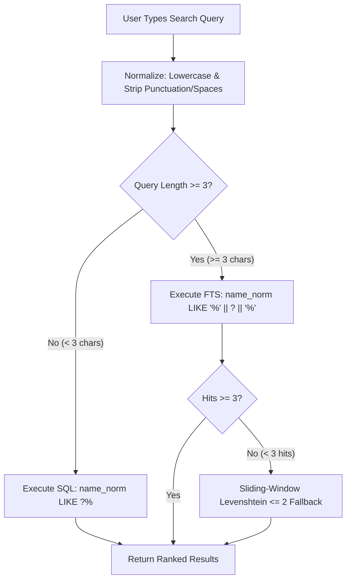

# FTP-Lantern — System Architecture (v3)

**FTP-Lantern** is a high-efficiency, zero-transcoding media indexing, search, and launcher application tailored for BDIX ISP HTTP media portals (specifically Dhaka-FLIX / `http://172.16.50.12/DHAKA-FLIX-12/`).

It runs as a single lightweight Go binary with an embedded Svelte 5 SPA, crawls ISP directory listings incrementally, extracts titles, years, quality, source, and resolutions, caches content-hashed poster thumbnails, provides sub-millisecond FTS5 search with typo tolerance, and generates 1-click streaming links (Windows PotPlayer/VLC, Android VLC/MX Player) with watch-history tracking.

---

## 1. High-Level Architecture

```
ISP BDIX Server (172.16.50.12/DHAKA-FLIX-12/...)
          │  Incremental HTTP crawl (Category Mtime + Hot-Set Seasons + Nightly Deep Crawl)
          ▼
┌───────────────────────── ftp-lantern (Single Go Binary) ─────────────────────────┐
│                                                                                  │
│  ┌────────────────────┐     ┌──────────────────┐     ┌────────────────────────┐  │
│  │   Crawler Engine   │ ──► │   Diff Engine    │ ──► │  SQLite 3 (WAL mode)   │  │
│  │  (DOM + Hot-Set)   │     │ (CircuitBreaker) │     │  - titles, releases    │  │
│  └─────────┬──────────┘     └────────┬─────────┘     │  - files, plays        │  │
│            │                         │               │  - events, settings    │  │
│            ▼                         ▼               │  - FTS5 trigram index  │  │
│    Poster Worker (Q=1)         Telegram Bot          └───────────┬────────────┘  │
│  (Single worker, max 96MB,  (Digest & Photo alerts               ▲               │
│   /data/thumbs/:id-:hash)    + Long-Polling Bot)                 │ REST API      │
│                                                                  │               │
│                                                      ┌───────────┴────────────┐  │
│                                                      │  Embedded Web UI       │  │
│                                                      │  (Svelte 5 / Vite SPA) │  │
└──────────────────────────────────────────────────────┴────────────────────────┴──┘
          │
          ├─► Android Devices: intent://... (navigator.sendBeacon() play tracking)
          ├─► Windows Desktops: /play/season/:id.m3u (Direct stream in PotPlayer / VLC)
          ├─► Telegram Client: Rich HTML alerts (escaped) + bot commands (/turbo, /status)
          └─► "Continue Watching": "Last played: S01E04 → Next: S01E05" + manual mark
```

> [!IMPORTANT]
> **Zero Video Transcoding / Direct Streaming:**  
> Media files (`.mkv`, `.mp4`) are **never** proxied, downloaded, or transcoded by FTP-Lantern. Native players (PotPlayer, VLC, MX Player) stream media bytes directly from the ISP server (`172.16.50.12`). FTP-Lantern consumes `< 30 MB` RAM on the host.

---

## 2. Technology Stack

| Layer | Selection | Justification & Performance Characteristics |
| :--- | :--- | :--- |
| **Backend** | **Go 1.23+ (`net/http`)** | Single static binary, zero runtime dependencies. Idle RAM `< 20 MB`. Goroutines handle parallel HTTP crawling without thread overhead. |
| **Timezone & CLI** | **`_ "time/tzdata"` + CLI subcommands** | Embedded timezone database for accurate quiet hours (`Asia/Dhaka`). Built-in `healthcheck` subcommand eliminates need for `curl` in scratch container. |
| **Database** | **SQLite + FTS5 (`modernc.org/sqlite`)** | Pure Go SQLite (no CGO required). Runs in WAL mode with default page sizing. Zero external container dependencies. Query execution: **1–3 ms**. |
| **Search Engine** | **FTS5 (`trigram`) via Parameterized `LIKE`** | SQLite accelerates `LIKE '%' || ? || '%'` directly on FTS5 trigram tables with zero manual escaping needed. Substring sliding-window Levenshtein fallback for partial typos. |
| **Image Pipeline** | **`disintegration/imaging` (Concurrency = 1)** | Dedicated single-worker queue prevents memory spikes (decoding 2000×3000 JPEG consumes ~24MB uncompressed). Resizes to ~300px JPEG Q75. Content-hashed URL (`/api/thumbs/:id-:hash.jpg`) with `Cache-Control: immutable`. |
| **Crawler Parsing** | **`PuerkitoBio/goquery` (HTML DOM)** | Robust fallback parser for Dhaka-FLIX custom tree layout and breadcrumbs. Does not assume standard h5ai API availability. |
| **Telegram Notifier** | **Plain HTTP via Go `net/http`** | HTML-escaped push alerts with photo/digest and 4xx circuit breaker, plus long-polling command listener (`/turbo`, `/status`) whitelisted to `TELEGRAM_ADMIN_CHAT_ID`. |
| **Frontend** | **Svelte 5 / Vite SPA** | Bundled and embedded into Go binary via `//go:embed`. Client bundle `< 40 KB` gzipped. Instant search-as-you-type with typeahead dropdown (100ms debounce). |
| **Deployment** | **Dokploy / Docker Compose** | Multi-stage build producing a minimal `scratch` image (`< 25 MB`). Named volume `lantern-data:/data` guarantees data persistence across Dokploy rebuilds. Mandatory `network_mode: host`. |

---

## 3. Crawler & Diff Engine Specification

### 3.1 Two-Tier Incremental Crawl Mechanics

Understanding filesystem mtime propagation on Linux servers allows optimizing crawls without missing episodes:
1. **Direct Children Propagate Mtime (Free Win):**
   - Category folders (`TV Series * 0 - 9`, `A - L`, `M - R`, `S - Z`) contain title folders as direct children.
   - There are only ~4 category folders in total. Therefore, **a quick crawl always fetches the category index pages** (4 fast HTTP requests, ~200ms total).
   - Inside the category listing, the crawler compares each title folder's `last_modified` against `releases.last_modified`:
     - If an entirely new title folder appeared &rarr; descend and index it (`new_title`).
     - If an existing title folder gained a new season (e.g. `Season 2/` added to `VisionQuest/`), `VisionQuest/`'s own `last_modified` changes &rarr; descend and index the new season (`new_season`).
   - **Result:** All new titles and all new seasons of cold shows are caught at the category level with zero extra crawl cost.
2. **Grandchildren Do Not Propagate Mtime (The Hot-Set):**
   - Adding a new episode (`S01E08.mkv`) inside `Season 1/` updates `Season 1/`'s timestamp, but leaves `VisionQuest/` and the category root unchanged.
   - **Dynamic Hot-Set Rule:** A title is evaluated dynamically as **Hot** if:
     ```sql
     is_following = 1 
     OR (SELECT MAX(last_modified) FROM files WHERE title_id = titles.id AND gone_at IS NULL)
        > datetime('now', '-45 days')
     ```
     *(Uses the ISP server's file timestamps, NOT the local `first_seen` DB insert date, ensuring weekly series stay hot as long as episodes keep dropping within 45 days).*
3. **Crawl Execution Flow:**
   - **Quick Crawl (Every 15–60 mins):**
     - Step 1: List the ~4 category folders. For any title folder whose `last_modified` changed, descend into it.
     - Step 2: Query dynamic hot-set series. Re-list their existing season folders (~30–50 fast HTTP requests).
     - Full check completes in **< 5 seconds**.
   - **Nightly Deep Crawl (04:00 AM):**
     - Crawls all folders with low concurrency (`2` workers) as a safety net.

### 3.2 Safe Diff & Subtree Circuit Breaker
- **Error Protection:** Network errors, ISP timeouts, or 5xx responses never trigger deletions.
- **Subtree Mass-Deletion Guard:**
  - Deletion checks operate strictly on the subtrees actually scanned.
  - If $> 20\%$ of items disappear within a scanned subtree (with a minimum threshold of $\ge 10$ items to prevent false positives on small folders), all deletions in that subtree are aborted, and an alert is logged.
- **First-Ever Crawl (Silent Seed):**
  - Populates SQLite without emitting Telegram notifications (`notified_at = CURRENT_TIMESTAMP`).
- **Non-Blocking Crawl Lock:**
  - `sync.Mutex.TryLock()`. If a crawl is already running, `POST /api/crawl/trigger` immediately returns `409 Conflict ("Crawl already in progress")`.

---

## 4. Metadata, Quality & URL Normalization

### 4.1 Granular Quality Regex
Folder names combine resolution, source, and dynamic range. The parser splits them into explicit database fields:

```go
var (
    resRegex    = regexp.MustCompile(`(?i)\b(4k|2160p|1080p|720p|480p)\b`)
    sourceRegex = regexp.MustCompile(`(?i)\b(web-?dl|webrip|bluray|bdrip|hdrip|hdtv)\b`)
    hdrRegex    = regexp.MustCompile(`(?i)\b(hdr10\+?|hdr|dv|dolby\s*vision)\b`)
)
```

- `resolution`: `4K`, `1080p`, `720p`, `480p`, `Unknown`
- `source`: `WEB-DL`, `WEBRip`, `BluRay`, `HDTV`, `Unknown`
- `has_hdr`: `boolean`
- **Title Card Badging:** Titles derive their displayed badge as the **highest resolution** among their active releases (e.g., if a show has 720p and 1080p uploads, display `1080p` emerald badge).

### 4.2 Logical Titles & Release Deduplication
The same show may be uploaded in separate 720p and 1080p folders, or moved when the ISP rebalances alphabetical categories.
- **Logical Title Identity:** `UNIQUE(name_norm, year)`. To ensure SQLite uniqueness works reliably, `year` is defined as `INTEGER NOT NULL DEFAULT 0` (preventing SQLite `NULL != NULL` duplication).
- **Category & Gone State on Releases:** Category is stored on `releases.category` (since folders can move between categories). A logical title is only considered `gone` when **all** its releases are gone.
- Reorganizing folders or uploading a 1080p upgrade triggers a `quality_upgrade` event or silent link update, never duplicate title cards.

### 4.3 Strict URL Percent-Encoding
ISP paths contain characters like `♦`, `—`, `[ ]`, spaces, and `#`.
- URLs are constructed strictly using Go's `net/url` package (`url.URL{Path: ...}`), never raw string concatenation.
- Avoids broken Android `intent://` URIs and ensures PotPlayer/VLC do not choke on `.m3u` playlists.

---

## 5. Instant Search with Parameterized Trigram FTS5 & Typo Tolerance



### 5.1 Robust Trigram Search Without Syntax Escaping
With SQLite's `trigram` tokenizer on FTS5, SQLite accelerates parameterized SQL `LIKE` statements directly through the FTS index:
```sql
SELECT rowid FROM titles_fts WHERE name_norm LIKE '%' || ? || '%'
```
- **Zero Syntax Escaping Required:** Uses standard SQL parameter binding (`?`), completely eliminating hand-rolled escaping for `"`, `*`, `-`, and `:`.
- **Short Query Fallback ($< 3$ chars):** Queries like "24" or "Up" fall back to `name_norm LIKE ? || '%'`.
- **Full Sliding-Window Levenshtein Fallback:** When FTS returns $<3$ results, typos are caught by sliding a window of length `len(query) ± 1` across the entire normalized title string (e.g. matching "visoin" against the window "vision" within "visionquest", yielding distance 1 instead of failing on full-string distance 7). The in-memory title list is refreshed whenever a crawl finishes with title changes.

---

## 6. 1-Click Streaming & Watch History Tracking

### 6.1 Native Player Launchers
Media files are streamed directly by client applications without proxying through FTP-Lantern:
1. **Android Devices (Reliable Navigation via `sendBeacon`):**
   ```javascript
   function playOnAndroid(fileId, intentUrl) {
     navigator.sendBeacon('/api/plays', JSON.stringify({ file_id: fileId }));
     window.location.href = intentUrl;
   }
   ```
   Uses `navigator.sendBeacon()` to guarantee the play event reaches the server even as Android switches focus to VLC or MX Player. The `/api/plays` backend endpoint parses the request body as JSON regardless of `Content-Type` header (handling `text/plain` from `sendBeacon`).
2. **Windows Desktops (Full Season Continuous Auto-Next):**
   `GET /play/season/:id.m3u` serves a UTF-8 playlist with natural `S01E01` ordering:
   ```m3u
   #EXTM3U
   #EXTINF:-1 tvg-name="VisionQuest S01E01",VisionQuest - S01E01 [1080p]
   http://172.16.50.12/DHAKA-FLIX-12/.../S01E01.1080p.mkv
   #EXTINF:-1 tvg-name="VisionQuest S01E02",VisionQuest - S01E02 [1080p]
   http://172.16.50.12/DHAKA-FLIX-12/.../S01E02.1080p.mkv
   ```
3. **Browser Fallback Notice:**
   Most ISP files are HEVC/x265 MKVs with AC3 5.1 audio. Browser playback is strictly treated as an experimental fallback for H.264/AAC MP4 files.

### 6.2 Watch History ("Continue Watching")
- Stored in the `plays` table.
- Since Windows playlists launch externally and auto-advance, the UI displays accurate semantics:
  `Last played: S01E04 → Next: S01E05`.
- Includes a manual checkmark button: **"Mark watched up to here"** to keep track when binge-watching in VLC/PotPlayer.

---

## 7. Telegram Bot & Notification Engine

### 7.1 Delivery, HTML Escaping & Queue Protection
- **Strict HTML Escaping:** All dynamic strings (titles like `Scott & Bailey` or `<Movie>`) are passed through `html.EscapeString()` before formatting into Telegram HTML messages.
- **Item-Boundary Truncation:** Digests are constructed item-by-item measuring the final HTML-escaped string length. Appending stops when approaching 3,800 characters, cleanly appending `...and X more (url)` without cutting across tags or character entities like `&amp;`.
- **Error Classification & Circuit Breakers:**
  - `200 OK`: Mark event `notified_at = CURRENT_TIMESTAMP`.
  - `429 Too Many Requests`: Respect `retry_after` response header and pause queue.
  - `5xx` / Network Timeout: Exponential backoff retry.
  - **Auth / Config Errors (`401 Unauthorized`, `403 Forbidden`, `400 chat not found`):** Indicates revoked token or wrong chat ID. Pauses the notifier, keeps events queued, and surfaces an error banner in `/status` and `/api/status`.
  - **Payload-Specific Errors (e.g. `400 can't parse entities`):** Marks only that single event `failed_at = CURRENT_TIMESTAMP` with logged reason, and **advances the queue** so subsequent notifications are not held hostage.

### 7.2 Dedicated Long-Polling Bot Listener
Runs a background goroutine using Telegram `getUpdates` (long-polling; requires zero public webhooks or open ports):
- Whitelisted exclusively to `TELEGRAM_ADMIN_CHAT_ID`.
- Commands:
  - `/status` — Host health, ISP reachability, item counts, active scheduler mode.
  - `/turbo [hours]` — Instantly activates Turbo Scan mode for X hours.
  - `/scan` — Triggers an immediate crawl.

---

## 8. Database Schema (SQLite 3 + FTS5)

```sql
PRAGMA journal_mode = WAL;
PRAGMA synchronous = NORMAL;
PRAGMA foreign_keys = ON;

-- Logical Titles Table
CREATE TABLE IF NOT EXISTS titles (
    id            INTEGER PRIMARY KEY AUTOINCREMENT,
    name          TEXT NOT NULL,
    name_norm     TEXT NOT NULL,
    year          INTEGER NOT NULL DEFAULT 0,     -- NOT NULL DEFAULT 0 ensures UNIQUE(name_norm, year) functions
    type          TEXT NOT NULL DEFAULT 'series', -- 'series' or 'movie'
    poster_url    TEXT,
    thumb_hash    TEXT,
    is_following  INTEGER NOT NULL DEFAULT 0,
    first_seen    DATETIME NOT NULL DEFAULT CURRENT_TIMESTAMP,
    last_modified DATETIME,
    UNIQUE(name_norm, year)
);

-- Releases Table (Folders on ISP server)
CREATE TABLE IF NOT EXISTS releases (
    id            INTEGER PRIMARY KEY AUTOINCREMENT,
    title_id      INTEGER NOT NULL REFERENCES titles(id) ON DELETE CASCADE,
    source_server TEXT NOT NULL DEFAULT 'DHAKA-FLIX-12', -- multi-server ready
    category      TEXT NOT NULL,                         -- 'TV-WEB-Series', etc.
    folder_url    TEXT NOT NULL UNIQUE,
    folder_name   TEXT NOT NULL,
    resolution    TEXT NOT NULL DEFAULT 'Unknown',       -- '1080p', '720p', '4K'
    source        TEXT NOT NULL DEFAULT 'Unknown',       -- 'WEB-DL', 'BluRay'
    has_hdr       INTEGER NOT NULL DEFAULT 0,
    first_seen    DATETIME NOT NULL DEFAULT CURRENT_TIMESTAMP,
    last_modified DATETIME,
    gone_at       DATETIME
);

-- Files Table (Episodes & Movie Files)
CREATE TABLE IF NOT EXISTS files (
    id               INTEGER PRIMARY KEY AUTOINCREMENT,
    release_id       INTEGER NOT NULL REFERENCES releases(id) ON DELETE CASCADE,
    title_id         INTEGER NOT NULL REFERENCES titles(id) ON DELETE CASCADE,
    season_number    INTEGER,                            -- NULL for movies
    episode_number   INTEGER,                            -- NULL for movies
    episode_code     TEXT,                               -- 'S01E05'
    name             TEXT NOT NULL,
    file_url         TEXT NOT NULL UNIQUE,
    file_size_bytes  INTEGER NOT NULL DEFAULT 0,
    resolution       TEXT NOT NULL DEFAULT 'Unknown',
    source           TEXT NOT NULL DEFAULT 'Unknown',
    has_hdr          INTEGER NOT NULL DEFAULT 0,
    first_seen       DATETIME NOT NULL DEFAULT CURRENT_TIMESTAMP,
    last_modified    DATETIME,
    gone_at          DATETIME
);

-- Watch History / Play Events
CREATE TABLE IF NOT EXISTS plays (
    id         INTEGER PRIMARY KEY AUTOINCREMENT,
    file_id    INTEGER NOT NULL REFERENCES files(id) ON DELETE CASCADE,
    title_id   INTEGER NOT NULL REFERENCES titles(id) ON DELETE CASCADE,
    played_at  DATETIME NOT NULL DEFAULT CURRENT_TIMESTAMP
);

-- Diff & Notification Events Table
CREATE TABLE IF NOT EXISTS events (
    id           INTEGER PRIMARY KEY AUTOINCREMENT,
    kind         TEXT NOT NULL,                          -- 'new_title', 'new_season', 'new_episodes', 'quality_upgrade'
    title_id     INTEGER NOT NULL REFERENCES titles(id) ON DELETE CASCADE,
    release_id   INTEGER REFERENCES releases(id) ON DELETE CASCADE,
    payload_json TEXT NOT NULL,
    created_at   DATETIME NOT NULL DEFAULT CURRENT_TIMESTAMP,
    notified_at  DATETIME,
    failed_at    DATETIME
);

-- Dynamic System & Scheduler Settings
CREATE TABLE IF NOT EXISTS settings (
    key   TEXT PRIMARY KEY,
    value TEXT NOT NULL
);

-- Full-Text Search Virtual Table with Trigram Tokenizer
CREATE VIRTUAL TABLE IF NOT EXISTS titles_fts USING fts5(
    name_norm,
    content='titles',
    content_rowid='id',
    tokenize='trigram'
);

-- FTS Trigger: Fires ONLY when name_norm updates
CREATE TRIGGER IF NOT EXISTS titles_ai AFTER INSERT ON titles BEGIN
    INSERT INTO titles_fts(rowid, name_norm) VALUES (new.id, new.name_norm);
END;

CREATE TRIGGER IF NOT EXISTS titles_ad AFTER DELETE ON titles BEGIN
    INSERT INTO titles_fts(titles_fts, rowid, name_norm) VALUES('delete', old.id, old.name_norm);
END;

CREATE TRIGGER IF NOT EXISTS titles_au AFTER UPDATE OF name_norm ON titles BEGIN
    INSERT INTO titles_fts(titles_fts, rowid, name_norm) VALUES('delete', old.id, old.name_norm);
    INSERT INTO titles_fts(rowid, name_norm) VALUES (new.id, new.name_norm);
END;
```

---

## 9. REST API Specification

| Endpoint | Method | Description |
| :--- | :--- | :--- |
| `/api/search` | `GET` | Instant search & filtering (`q`, `resolution`, `source`, `type`, `page`, `limit`) |
| `/api/titles/:id` | `GET` | Detailed title payload with releases, files, and watch progress |
| `/api/titles/:id/follow` | `POST` | Toggle watchlist status |
| `/api/plays` | `POST` | Record playback event (`file_id`) via `navigator.sendBeacon()` |
| `/api/plays/mark-watched`| `POST` | Mark episodes watched up to specified `file_id` |
| `/api/new` | `GET` | Feed of recently indexed content (`since`, `limit`) |
| `/api/thumbs/:id-:hash.jpg`| `GET` | Content-hashed poster thumbnail with `Cache-Control: immutable` |
| `/play/file/:id.m3u` | `GET` | Ephemeral single-file M3U playlist file |
| `/play/season/:id.m3u` | `GET` | Full season M3U playlist file with natural episode ordering |
| `/api/scheduler` | `GET` | Current crawl interval, next run, and Turbo Mode status |
| `/api/scheduler/turbo` | `POST` | Enable Turbo Mode (`{ "interval_minutes": 15, "duration_hours": 10 }`) |
| `/api/crawl/trigger` | `POST` | Immediate manual crawl execution (non-blocking `TryLock`) |
| `/api/status` | `GET` | Health status: ISP gateway ping, DB item count, memory usage |

---

## 10. Dokploy & Docker Deployment

### 10.1 Network Mode & Volume Guardrails
- **Host Networking:** Containers run with `network_mode: host` to guarantee direct routing to `172.16.50.12` without Docker bridge NAT collision.
- **Dokploy Named Volume Persistence:** Rather than relative `./data` (which can be wiped during Dokploy git rebuilds), deployment uses a named volume `lantern-data:/data` or Dokploy's persistent storage mount (`../files/ftp-lantern-data:/data`).
- **Memory Boundary:** Set `GOMEMLIMIT=96MiB` to ensure Go's GC collects memory before reaching the container's 128MB limit.

### 10.2 Docker Compose (`docker-compose.yml`)

```yaml
services:
  ftp-lantern:
    build:
      context: .
      dockerfile: Dockerfile
    container_name: ftp-lantern
    network_mode: host
    restart: unless-stopped
    volumes:
      - lantern-data:/data
    environment:
      - PORT=8085
      - SOURCE_URLS=http://172.16.50.12/DHAKA-FLIX-12/TV-WEB-Series/
      - BASE_CRAWL_INTERVAL_MINUTES=60
      - CRAWL_CONCURRENCY=4
      - GOMEMLIMIT=96MiB
      - PUBLIC_BASE_URL=http://192.168.0.134:8085
      - TELEGRAM_BOT_TOKEN=${TELEGRAM_BOT_TOKEN}
      - TELEGRAM_ADMIN_CHAT_ID=1240674937
      - TZ=Asia/Dhaka
      - LOG_LEVEL=info
    deploy:
      resources:
        limits:
          cpus: '0.50'
          memory: 128M

volumes:
  lantern-data:
    name: ftp-lantern-data
```

### 10.3 Multi-Stage Dockerfile with Healthcheck Subcommand
```dockerfile
# Global ARG before first FROM for use across stages
ARG GO_VERSION=1.23

# Stage 1: Build Frontend Assets
FROM node:20-alpine AS frontend-builder
WORKDIR /app/frontend
COPY frontend/package*.json ./
RUN npm ci
COPY frontend/ ./
RUN npm run build

# Stage 2: Build Static Go Binary
FROM golang:${GO_VERSION}-alpine AS backend-builder
WORKDIR /app
RUN apk add --no-cache ca-certificates
COPY go.mod go.sum ./
RUN go mod download
COPY . .
COPY --from=frontend-builder /app/frontend/dist ./server/ui/dist
RUN CGO_ENABLED=0 GOOS=linux go build -ldflags="-s -w" -o /ftp-lantern .

# Stage 3: Minimal Scratch Container
FROM scratch
WORKDIR /
COPY --from=backend-builder /etc/ssl/certs/ca-certificates.crt /etc/ssl/certs/
COPY --from=backend-builder /ftp-lantern /ftp-lantern
VOLUME ["/data"]
EXPOSE 8085
HEALTHCHECK --interval=30s --timeout=3s --retries=3 \
  CMD ["/ftp-lantern", "healthcheck"]
ENTRYPOINT ["/ftp-lantern"]
```

---

## 11. Performance & Operational Targets

- **Container Image Size:** $\le 25 \text{ MB}$.
- **Host Memory Footprint:** $\le 30 \text{ MB}$ RAM under peak crawl; $\le 18 \text{ MB}$ at idle (`GOMEMLIMIT=96MiB` safeguard).
- **Poster Concurrency:** Capped at 1 worker to prevent memory spikes during large image decoding.
- **Search Latency:** $\le 3 \text{ ms}$ for FTS5 trigram queries across 10,000+ items via parameterized `LIKE`.
- **Hot-Set Quick Crawl:** $\le 5 \text{ seconds}$ across active series.
- **Resource Discipline:** Strict 128 MB RAM / 0.5 CPU cap.
